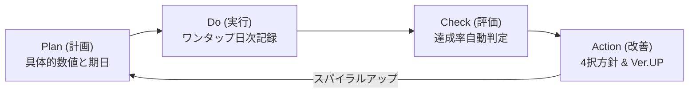

# PDCA Check 公式操作・運用マニュアル

「PDCAを記録する」のではなく、**「目的達成に向けてPlanを改善し続け、チームが自走する」**ための目標管理LINEミニアプリ（LIFF）です。

---

## 目次
1. [コアコンセプト & 設計思想](#1-コアコンセプト--設計思想)
2. [個人PDCAの基本フロー](#2-個人pdcaの基本フロー)
3. [Googleカレンダー行動連携（新機能）](#3-googleカレンダー行動連携新機能)
4. [履歴（History）画面](#4-履歴history画面)
5. [チーム管理（管理者向け）機能](#5-チーム管理管理者向け機能)
6. [完全無料（0円）運用の仕組み](#6-完全無料0円運用の仕組み)
7. [よくある質問（FAQ）](#7-よくある質問faq)

---

## 1. コアコンセプト & 設計思想

### ① 指示待ちをつくらない「自走型」PDCA
- **「確認のみ」で管理者がストッパーにならない**: 管理者のチェック待ちでメンバーの作業が止まる状態を排除。
- **「アドバイス」で本人の気づきを促す**: 指示命令ではなく、本人が自分で次の一手を打てるヒントを提供。
- **「承認」や「承認不要」の不要な上下関係表記を全廃**: 自発的な行動とチームの自走を最大化します。

### ② スマホ＆LINEファーストの「習慣化」
- インストール不要。LINEアプリ内（LIFF）から数秒で日次実績をワンタップ入力。
- 行動忘れを防ぐGoogleカレンダーの行動枠予約（タイムブロッキング）をサポート。

---

## 2. 個人PDCAの基本フロー

### Step 1: Plan（計画・目標）
1. 画面下部の【Plan作成】をタップ。
2. **目的（Objective）**を選択または新規入力（例:「売上目標の達成」「健康的な生活」）。
3. **具体的な行動（Do）**を入力（例:「新規架電アプローチ」）。
4. **目標数値と単位・頻度・期日**を設定（例:「毎日 20件」「期日: 2026/10/31」）。
   - *コツ: 達成確率が80%程度と感じられる現実的な数字から始めると継続習慣が身につきます。*

### Step 2: Do（実行・記録）
1. ホーム画面に登録中の目標カードが表示されます。
2. 毎日の行動終了後、【＋1】【＋5】クイックボタンまたは数値入力で実績を即時記録。
3. 今日の達成状況や進捗バーがリアルタイムに更新されます。

### Step 3: Check（評価・振り返り）
1. 設定した期日の到来時や振り返り時に【Check（評価）へ進む】をタップ。
2. 期間内の合計実績から達成率（％）が自動算出され、**達成（🎉）**または**未達（⚠️）**を判定。
3. 「何が要因だったか」「どんなボトルネックがあったか」を簡単にメモ。

### Step 4: Action（改善・次の計画）
1. 振り返り結果をもとに、次サイクルの4択方針を選択：
   - **継続する**: 現行の行動をそのまま次の期間も続ける。
   - **修正する（Ver.UP）**: 目標値や行動方法を改善してバージョンアップ（v1 ➔ v2）。
   - **別の手段を試す**: 目標達成に向けた別のアプローチに切り替える。
   - **終了する**: 目標を達成したため完了とする。
2. 保存すると目標が自動で進化し、過去の記録は「履歴」へ蓄積されます。

---

## 3. Googleカレンダー行動連携（新機能）

> **「最終締め切り日の1日だけ通知されても、毎日の行動が続かない」を解消！**

Plan作成時や日次カードの【カレンダー登録】から、**毎日の行動枠（タイムブロック）**をGoogleカレンダーにワンタップで登録できます。

### 選択できる時間帯スロット
- ☀️ **朝（09:00 〜 09:30）**: 朝の業務開始時に行動枠を確保
- 🕛 **昼（12:30 〜 13:00）**: 昼休みの隙間時間に行動
- 🌆 **夕方（18:00 〜 18:30）**: 業務終盤のまとめ時間
- 🌙 **夜（21:00 〜 21:30）**: 夜の自己研鑽・学習
- 📅 **終日タスク**: 時間帯を縛らず毎日リマインド
- ⏰ **時間を指定**: 任意の開始時刻（例: 10:00）と所要時間（15分/30分/60分）を指定可能

### 自動設定されるカレンダー仕様
- **毎日リピート**: `RRULE:FREQ=DAILY` により、締め切り期日まで毎日自動でカレンダーにスケジュールが登録されます。
- **行動ベースのタイトル**: `【PDCA実行】新規架電アプローチ (目標: 20件)`
- **アプリ直通URL**: カレンダーの予定詳細からワンタップでPDCA入力画面を開けます。
- *※必要に応じて「最終評価期日のみ」の登録にもタブで切り替え可能です。*

---

## 4. 履歴（History）画面

- **目的（Objective）別のグルーピング整理**:
  - 設定した大目的（例:「営業スキルの向上」「生活習慣の改善」）ごとに目標が体系化されて表示されます。
- **バージョン変遷（v1 ➔ v2 ➔ v3）の可視化**:
  - 過去の達成・未達結果、記録した日次実績数値、改善コメントの変遷をいつでも時系列で振り返ることができます。

---

## 5. チーム管理（管理者向け）機能

管理者ダッシュボード（`/team`）から、配下メンバーのPDCAサイクルの滞りをリアルタイムに検知し、自走を支援できます。

### ① マルチテナント自組織分離（安全性）
- 管理者ごとに独立した組織（`organizations`）が作成され、自チームのメンバーのみが表示されます。
- 他チームのデータや個人Planと混ざることはありません。

### ② LINE友だち招待
- 【LINE友だちを追加】をタップすると、送信メッセージのプレビューが表示されます。
- LINEの友だちリストから直接メンバーを選んで招待状を送信可能（URLコピーによるグループ共有も対応）。

### ③ サイクルの滞り検知（3つのフィルター）
- **確認待ち**: メンバーがCheckを提出し、管理者の確認を待っている状態。
- **アドバイス**: 管理者から改善のヒントを共有中の状態。
- **確認済み**: 順調に自走継続中の状態。

### ④ 自走レビュー機能
メンバーのカードにある【提出内容をレビューする】から、以下の2通りでフィードバックできます：
- **✅ 確認のみ**: 管理者で止めず、順調な自走をそのまま継続させます。
- **💡 アドバイス**: 指示命令にせず、本人が自分で次の一手を打てるよう気づき・ヒントを共有します（コメント未入力でも自走を促すアドバイスが自動送信されます）。

### ⑤ チーム情報の変更・メンバー除名
- チーム名や招待コードは【✏️ 変更】からいつでも更新可能。
- メンバーの除名（チーム解除）もワンタップで安全に実行できます。

---

## 6. 完全無料（0円）運用の仕組み

LINE公式アカウントの月間メッセージ通数課金（Push API）を一切使用しない設計を採用しています。

| 機能 | 仕組み | コスト |
| :--- | :--- | :--- |
| **毎日の行動リマインド** | Googleカレンダーの繰り返し予定＋スマホ端末のアラーム通知 | **完全無料（0円）** |
| **チーム招待** | LIFF `shareTargetPicker`（友だち選択送信画面） | **完全無料（0円）** |
| **締め切りリマインド** | LIFF `shareTargetPicker` によるLINE送信 | **完全無料（0円）** |
| **データ保存** | Supabase クラウドデータベース連携 | **無料枠内で完結** |

---

## 7. よくある質問（FAQ）

#### Q. 目標の数値を間違えて入力した場合は直せますか？
**A.** ホーム画面の各目標カードにある「鉛筆（編集）アイコン」から、目標値や行動内容をいつでも修正できます。

#### Q. LINEミニアプリを閉じた後、データは消えませんか？
**A.** クラウド（Supabase）とLINEアカウントに自動保存されているため、アプリを閉じたりスマホを再起動してもデータが消えることはありません。

#### Q. チームメンバーが参加したのに画面に出てきません。
**A.** メンバーが招待URL（`/join?code=...`）から参加登録を完了すると、管理者のダッシュボードにリアルタイムで反映されます。画面下へスワイプするか再読み込みしてください。

---

*マニュアル最終更新: 2026年10月*
